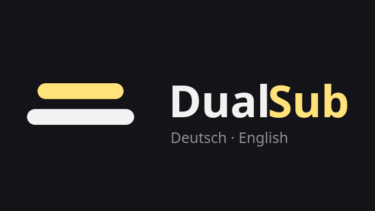
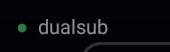

# DualSub Overlay



**Live translated subtitles on top of any Android TV app.** It reads the
subtitle off the screen, translates it, and shows the translation just above
the original — German → English, or English → German.


<sub>Captured on the TV with Prime Video playing. Prime's video is protected and
captures black; on the screen the picture is behind the text.</sub>

## Features

- **Works with any app** — Prime Video, ARD, Hotstar, YouTube. No integration,
  no plugin: if a subtitle is on screen, it gets translated.
- **Both directions, detected per line** — German gets English, English gets
  German. Or fix the direction on the app's screen.
- **Reads real-world subtitles** — two-speaker dialogue (`- … / - …`), sound
  descriptions (`[sie lacht]` → `[she laughs]`), and the coloured,
  teletext-style subtitles German broadcasters use.
- **About a second behind** the original, on a budget 32-bit TV chip.
- **Light on the TV** — idles between lines, backs off on menus, ~65 MB of RAM.
- **Tells you what it's doing** — a faint corner dot (green / red on error) and
  an event log on the app's screen; `~` marks a line it couldn't read.
- **Private by design** — OCR runs on the TV; only the subtitle text goes to the
  translator.

## How it works

```
 screen ──► change check ──► OCR ──► language ──► DeepL ──► overlay
 capture    (200 ms, cheap)  (Tesseract,  (DE or EN)          (above the
                              on device)                       subtitle)
```

| Problem | Solution |
| --- | --- |
| No app exposes its subtitle text to other apps | Capture the screen and OCR the subtitle band. Protected video captures black, which leaves clean text on black — ideal for OCR. |
| Google's ML Kit OCR crashes (`SIGILL`) on the TV's 32-bit kernel | Tesseract, with German and English models; English loads only when needed. |
| OCR too slow on a 4-core 1.3 GHz chip | Read only the text's bounding box, one line per engine in parallel; 2 engines × 2 threads halved OCR time (4 threads each was fighting over the cores). |
| The overlay would read its own translation back in | Subtitles use pure colours (each channel fully on or off); the overlay's yellow has blue at half, so it never counts as text. |
| Menus and home screens burned CPU | Only centred text counts as a subtitle; after repeated misses it checks once a second until the subtitle area is clear. |
| Fading subtitles and player controls produce junk | Confidence threshold, a second read must agree for borderline lines, and a letters-vs-symbols check. |
| Some ARD uploads are sped up, subtitles drift | Handled in the sibling Kodi addon, `mediathek-dualsub`. |

## Performance

Measured live on Prime Video on a TCL Android 11 TV (Realtek, 4× Cortex-A55 @
1.3 GHz, 32-bit, 2 GB RAM):

| | |
| --- | --- |
| Translation shown after a one-line subtitle | ~1.0 s |
| … after a two-line subtitle | ~1.5 s |
| OCR per subtitle (median) | ~0.5 s |
| Memory | ~65 MB (+10 MB once English OCR loads) |
| CPU while subtitles change | under one core on average, up to three for ~0.5 s per new line |
| CPU on menus | a cheap check once a second |

## Use

Open **DualSub Overlay**, press **Turn on** — it returns to whatever was
playing. Open it again to turn it off, change direction (*Auto-detect*,
*German → English*, *English → German*), or see what it has been doing:


While it runs, a faint dot sits in the top-left corner — green while working,
red after an error until the next line translates:



## Setup

```
./gradlew assembleDebug
adb install -r app/build/outputs/apk/debug/app-debug.apk

# allow screen capture without a prompt, and drawing over other apps
adb shell appops set de.dualsub.overlay PROJECT_MEDIA allow
adb shell appops set de.dualsub.overlay SYSTEM_ALERT_WINDOW allow
```

A [DeepL API](https://www.deepl.com/pro-api) key (the free tier is plenty) goes
in the app's private storage, `files/deepl_key` — copied from a file on the TV
so it never appears as a command-line argument:

```
adb shell 'run-as de.dualsub.overlay mkdir -p files;
           cat /path/on/tv/key.txt | run-as de.dualsub.overlay sh -c "cat > files/deepl_key"'
```

<details>
<summary>adb commands, logs and the OCR benchmark</summary>

```
adb shell am start -n de.dualsub.overlay/.StartActivity --es action start
adb shell am start -n de.dualsub.overlay/.StartActivity --es action stop
adb logcat -s DualSubOcr          # every line, with its timings
```

The benchmark runs the live OCR on saved screenshots in `files/bench/*.png`, so
settings can be compared on identical input:

```
adb shell am start -n de.dualsub.overlay/.StartActivity \
    --es action bench --ei omp 2 --ei engines 2
adb logcat -s DualSubOcr | grep BENCH
```

`omp` is OpenMP threads per engine. One engine (`--ei engines 1`) saves ~15 MB
and peak CPU but leaves two-line subtitles ~2 s behind.

</details>

## Next steps

- **Any language pair** — Tesseract has ~100 languages and DeepL ~30; download
  the two OCR models a user picks, and let the translator detect each line's
  language.
- **No API key** — Google ML Kit's on-device translation is free and offline
  (~59 languages). Its OCR crashes on this TV, so the translator needs testing
  on 32-bit devices first; DeepL would stay as the higher-quality option.
- **Phone and tablet version** — the same pipeline, where the overlay
  permission is a normal settings toggle; a far larger audience than TV.
- **Play Store** — needs the overlay permission to be grantable without adb
  (many TV builds hide it), a privacy policy, and the current target SDK.
- **Learning mode** — keep the lines you've seen with their translations and
  export them as flashcards (e.g. Anki).

## Credits

OCR models `deu` and `eng` from
[tesseract-ocr/tessdata_fast](https://github.com/tesseract-ocr/tessdata_fast)
(Apache 2.0). OCR via
[Tesseract4Android](https://github.com/adaptech-cz/Tesseract4Android).
