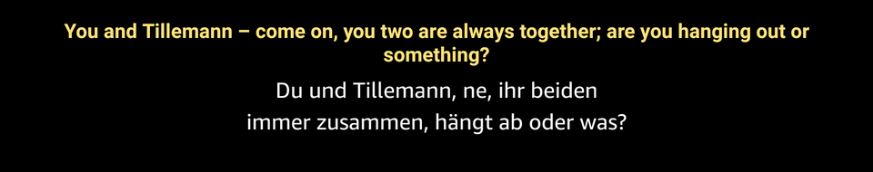
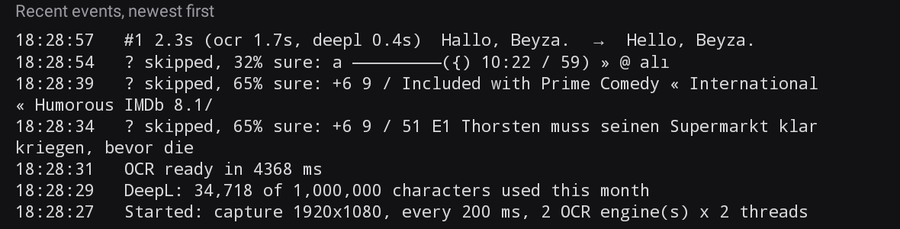

# DualSub Overlay


An Android TV app that puts a translation above the subtitles of **any** app —
Prime Video, ARD, Hotstar, YouTube. German subtitles get English, English ones
get German.

It reads the subtitle off the screen, translates it with DeepL, and draws the
translation in yellow just above the original:




*Captured on the TV. Prime's video is protected and captures black — on the
screen the picture is behind the text.*

A faint dot in the top-left corner shows it is on — green while working, red
after an error:


## How it works

1. **Capture** — a MediaProjection stream of the screen. Protected video (Prime)
   comes through black, but the app's subtitles do not: ideal for OCR.
2. **Detect** — every 200 ms a sparse sample of the bottom 30% is checked; only
   when the near-white text in it changes is the band converted in full, and
   only centred text is treated as a subtitle. After five rejected reads in a
   row (menus, home screens) it checks once a second until the subtitle area
   is clear again, and a static non-subtitle is retried at most twice.
3. **OCR** — the text's bounding box is split into lines, and the lines are read
   in parallel by two Tesseract engines (`tessdata_fast` models). Each line is
   read with the model for the expected language — the fixed direction, or the
   previous line's — and read again with the other one only when the language
   switches. The English engines load in the background the first time an
   English line turns up (~10 s on the TV below, during which the German model
   reads English, a little less accurately) — or straight away when the
   direction is set to *English → German*. German-only viewing never loads
   them.
   Low-confidence reads — fading subtitles, the player's own controls — are
   dropped unless two reads in a row agree.
4. **Translate** — DeepL, over a kept-alive connection, with a cache for lines
   that recur. The direction is set on the app's screen: *Auto-detect* (the
   default) tells each line's language from its words — der/die/und/ist and
   umlauts against the/and/you/is — and a line with no clue keeps the previous
   one's; or fixed *German → English* / *English → German*. Two speakers (`- …` / `- …`) stay on separate lines; a sentence
   wrapped over two lines is translated as one.
5. **Overlay** — the English sits above the tallest German seen so far, so a
   new two-line subtitle never runs into it, and stays 2.5 s after the German
   goes. A new line that cannot be read with confidence shows `~` instead.
   Only pure-colour pixels count as subtitle (white, and the teletext colours
   ARD uses for speakers), so the overlay's half-blue yellow is never read
   back in.

Measured live on Prime Video on a TCL Android 11 TV (Realtek, 4× Cortex-A55 @
1.3 GHz, 32-bit): the English appears ~1.0 s after a one-line German subtitle
and ~1.5 s after a two-line one. About 65 MB of RAM. While subtitles are being
read the app averages under one core, peaking at three for about half a second
per new line; on menus it backs off to a cheap check once a second.

One engine instead of two (`--ei engines 1`) needs ~50 MB and less CPU at peak,
but leaves two-line subtitles ~2 s behind.

Why Tesseract and not ML Kit: ML Kit's OCR library dies with `SIGILL` on this
TV's 32-bit kernel.

## Build and install

```
./gradlew assembleDebug
adb install -r app/build/outputs/apk/debug/app-debug.apk

# skip the screen-capture consent dialog and allow drawing over other apps
adb shell appops set de.dualsub.overlay PROJECT_MEDIA allow
adb shell appops set de.dualsub.overlay SYSTEM_ALERT_WINDOW allow
```

The DeepL key lives in the app's private storage, `files/deepl_key`. Put it
there without it ever appearing as a command-line argument, e.g. from a file
already on the TV:

```
adb shell 'run-as de.dualsub.overlay mkdir -p files;
           cat /path/on/tv/key.txt | run-as de.dualsub.overlay sh -c "cat > files/deepl_key"'
```

(`run-as` works because this is a debug build.)

## Use

Open **DualSub Overlay** and press **Turn on** — it returns to whatever was
playing. Open it again to turn it off.

The same screen is the place to look when something seems wrong: a status line
(lines translated, typical delay, unclear reads skipped, DeepL usage this
month), the last error in red, and the last 24 events newest first, each
translated line with its timings. Events are kept in `files/events.log`, so
they survive a crash. While it runs, the `● dualsub` dot in the top-left is
green, and turns red on an error until the next line translates.



From adb:

```
adb shell am start -n de.dualsub.overlay/.StartActivity --es action start
adb shell am start -n de.dualsub.overlay/.StartActivity --es action stop
adb logcat -s DualSubOcr          # every line, with its timings
```

## Benchmark

Same OCR as live, on saved screenshots in `files/bench/*.png`, so settings can
be compared on identical input:

```
adb shell am start -n de.dualsub.overlay/.StartActivity \
    --es action bench --ei omp 2 --ei engines 2
adb logcat -s DualSubOcr | grep BENCH
```

`omp` is OpenMP threads per engine. 2 engines × 2 threads (the default) was
fastest on the TV above; 4 threads per engine, the library default, was nearly
twice as slow.

## Credits

OCR models: `deu.traineddata` and `eng.traineddata` from
[tesseract-ocr/tessdata_fast](https://github.com/tesseract-ocr/tessdata_fast)
(Apache 2.0). OCR via
[Tesseract4Android](https://github.com/adaptech-cz/Tesseract4Android).
